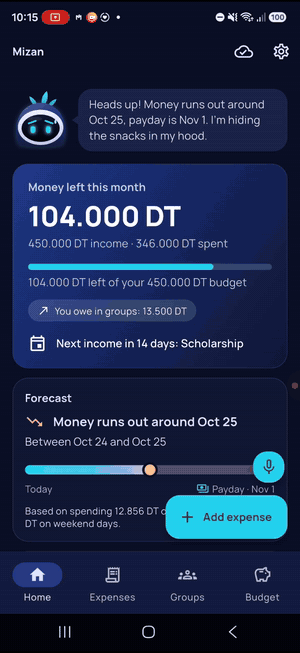
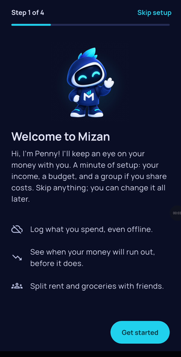
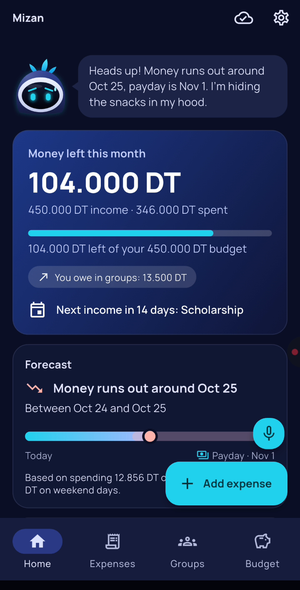
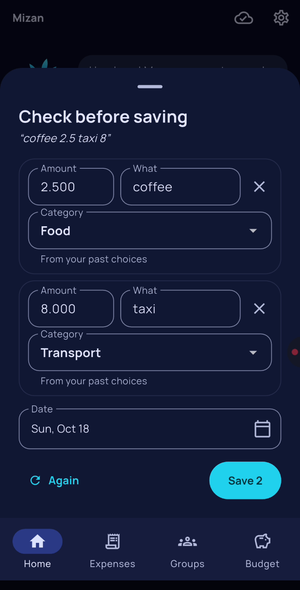
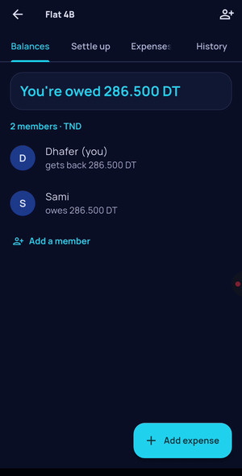
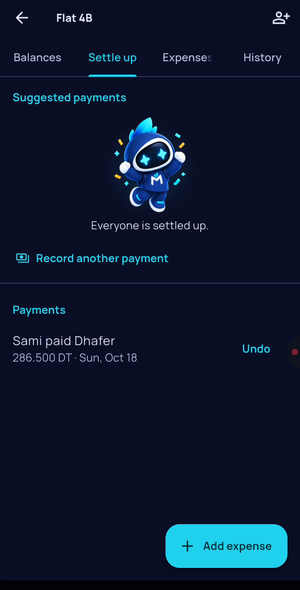
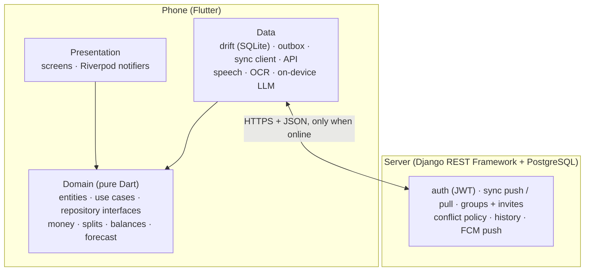
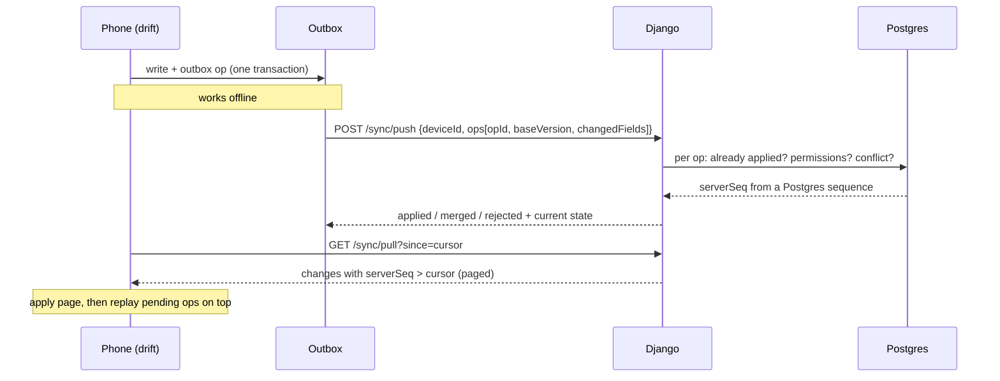

# Mizan

**An offline-first finance app for students.** It tracks what you spend, warns you *before* your money runs out, and splits rent with your roommates. It works fully offline and syncs through a Django server when online. Voice and receipts are read on the phone.

[](https://github.com/dhafer123/Mizan/actions/workflows/app.yml)
[](https://github.com/dhafer123/Mizan/actions/workflows/server.yml)
[](https://github.com/dhafer123/Mizan/actions/workflows/e2e.yml)

<p align="center">
  
</p>

<p align="center"><sub>Real recording on a Galaxy A16, sped up: voice entry → the forecast moves a day earlier → rent split with Sami → Sami pays back from his phone → settled.</sub></p>

| Setup | Home and forecast | Voice entry | Shared rent | Settled |
|:-:|:-:|:-:|:-:|:-:|
|  |  |  |  |  |

## Why

Student budgets fail at the end of the month, when it's too late to do anything. Mizan answers one question early: **at this pace, when does my money run out, and is that before payday?** It also handles the other student money problem: shared rent and groceries, with balances that always add up.

It's a portfolio project, built in six weeks. Correctness (money, sync), clean architecture, tests and measured numbers matter as much as the features.

## Features

- **Run-out forecast.** A weighted daily rate (weekdays and weekends apart) projects your balance to the next payday, with a likely range ([ADR 0012](docs/decisions/0012-run-out-forecast.md)). A backtest tool replays it day by day on an exported spending history ([ADR 0014](docs/decisions/0014-forecast-backtest.md)).
- **Budget alerts** before you cross a category or monthly limit, as notifications.
- **Voice and receipts, on the phone.**
  - Say "coffee 2.5 and taxi 8" (English, French or Tunisian Darija). A rule parser reads it, and a small on-device LLM (Qwen2.5 0.5B) steps in only when the rules aren't sure.
  - Receipts are read with on-device OCR.
  - **Nothing is saved until you confirm it.**
- **Groups and splits.**
  - Splits can be equal, exact, by percentage or by shares, in integer millimes, with largest-remainder rounding.
  - Debts are simplified into a few direct payments, the same on every phone.
  - Invite links, and placeholder members for roommates not on the app yet.
- **Offline first.** Every screen reads the local database. Changes queue in an outbox and sync when you're back online, with field-level merges and history.
- **Penny**, the mascot: her mood follows your forecast and budget, and she has a joke for most occasions. She never replaces words: screen readers and reduced motion get the same information.
- **Accessible and polished.**
  - Light and dark themes, contrast-tested.
  - Text up to 2× size.
  - Screen-reader labels throughout.
  - A "Reduce motion" switch that turns off every animation and haptic.
  - App lock (PIN or biometrics) and CSV export.

## In numbers

Measured on a **Samsung Galaxy A16** (4 GB RAM, 90 Hz screen), medians of 10 runs. Method and history are in [METRICS.md](docs/METRICS.md).

| | |
|---|---|
| Cold start (release) | **0.42 s** |
| Scrolling 2,000 expenses | **0.58%** of frames over the 11.1 ms budget (build p99 7.4 ms) |
| Opening a month with 2,000 expenses | **56 ms** |
| Sync: push 500 offline changes and pull the result | **4.4 s** |
| Sync: a new phone pulls 500 changes | **0.91 s** |
| APK (arm64) | **64.5 MB**, down from 101.4 MB by dropping unused native libraries ([ADR 0026](docs/decisions/0026-performance-measurements.md)) |
| Domain test coverage (`core/` + every `domain/`) | **96.4%** (2,193 / 2,276 lines), enforced ≥ 90% in CI |
| Sync simulation | **1,000 / 1,000** random multi-device scenarios per CI run keep all 4 sync invariants (about 16,800 ops each run) |
| Property tests (splits, balances, debt simplification) | 13 invariants × 1,000 random cases |
| Voice parser, rules only | **90.2%** of 61 phrases in 3 languages fully right; none wrong above its confidence threshold |
| Category suggestions after learning from corrections | **90.0%** on a 60-note test month (61.7% with keywords only) |

## Architecture

Clean architecture per feature, with one rule enforced in CI: **`presentation → domain ← data`**. `domain/` is pure Dart, with no Flutter, database, HTTP or plugin imports. A script fails the build if one appears.



- **The local SQLite database is the source of truth for the UI.** Screens never wait for the network.
- **Money is `Money(int minorUnits, Currency)`**, never `double`. It's parsed and formatted only at the edge.
- **Balances and totals are never stored.** They're computed from rows, and property tests prove they sum to zero.
- **Settlements are insert-only.** A mistake is fixed with a reversing payment, so history stays honest.
- **The server re-validates everything:** share sums, membership, permissions.

```
app/lib/
  core/        money, result, ids (UUIDv7), clock
  features/    expenses · budget · groups · sync · quick_input · auth · settings · mascot
               each: domain/ (entities, value objects, repositories, use cases)
                     data/ (drift DAOs, repositories, mappers, remote)
                     presentation/
server/        accounts · ledger · sync · groups · notifications · beta · demo
```

Full design: [docs/ARCHITECTURE.md](docs/ARCHITECTURE.md). Every non-obvious choice has a short ADR in [docs/decisions/](docs/decisions/) (26 so far).

## How sync works



1. **IDs come from the phone (UUIDv7)**, so records are created offline without asking anyone.
2. **Every local write is one database transaction that also appends to the outbox.** Nothing changes without a matching op.
3. **The server orders changes** with a global `serverSeq` from a Postgres sequence. It never uses device clocks, because phone clocks are wrong too often.
4. **Ops are idempotent.** The server stores every applied `opId`, so a retried push after a lost response is harmless.
5. **Conflicts are resolved per field:**

   | Case | Rule |
   |---|---|
   | Two edits change different fields | Both are kept (merged) |
   | Two edits change the same field | The later one (by server order) wins; the other is kept in history |
   | Edit vs delete | The delete wins; the row can be restored from history |
   | Settlements | Insert-only: no conflicts possible |

6. **Pull is paged by `serverSeq`.** The phone applies a page, then replays its own pending ops on top, so unsynced edits stay visible.
7. **Sync runs on its own:** at app start, when the connection comes back, shortly after a local write, on a push notification, and periodically in the background.

Four invariants are tested on every CI run, by a simulation of 2–3 phones making random edits with random offline periods and lost responses:
- **Convergence:** every phone ends with the same rows.
- **No lost writes:** every op is applied, merged, or recorded in history with a reason.
- **Money integrity:** group balances sum to 0 on every phone, after every step.
- **Idempotency:** pushing the same op twice changes nothing.

## Tests

| Level | What | How |
|---|---|---|
| Domain | Money, splits, balances, debt simplification, forecast, alerts, parsers | `test` + property-based tests with `glados` |
| Data | DAOs, outbox transactions, mappers, migrations | drift on an in-memory SQLite |
| Sync simulation | 1,000 random multi-phone scenarios against a fake server, plus 150 against the real Django server | Dart test harness |
| Widgets | Every screen's loading, empty, error and data states | `flutter_test` |
| Accessibility | Every main screen, both themes, 1× and 2× text: contrast, tap targets, labels, overflow | `flutter_test` guidelines |
| Server | API, permissions, conflicts, idempotency, invites, demo data | `pytest-django` on PostgreSQL |
| End to end | The real sync client against a real server in CI | `test_e2e` |
| On device | Performance in profile mode; voice and receipt accuracy | `integration_test` + `flutter drive` |

About **2,200 app tests** and **230 server tests** run in CI, alongside `flutter analyze`, the domain import check, the coverage gate, Django's checks, a migrations check and a `docker compose` smoke test.

## Run it

**App** (Flutter 3.38+, Dart 3.10):

```bash
cd app
flutter pub get
dart run build_runner build --force-jit
flutter analyze && flutter test
flutter run                     # emulator: talks to http://10.0.2.2:8000
flutter run --dart-define=MIZAN_API_URL=http://<your PC's LAN IP>:8000   # a real phone
```

**Server** (Python 3.12, PostgreSQL):

```bash
cd server
docker compose up               # Postgres + API on http://localhost:8000/health
# or on the host, with a local Postgres (see server/README.md):
DJANGO_DEBUG=1 python manage.py migrate
DJANGO_DEBUG=1 python manage.py runserver 0.0.0.0:8000
pytest
```

**Demo data:** two accounts (Dhafer and his roommate Sami) with a month of spending and a shared flat:

```bash
python manage.py seed_demo --reset      # sign in as dhafer@example.com / mizan-demo-2026
python manage.py demo_roommate pay      # Sami pays back, as if from his phone
```

**More checks:**

```bash
cd app
MIZAN_E2E_URL=http://127.0.0.1:8000 flutter test test_e2e        # real sync against your server
flutter drive --profile --no-dds --driver=test_driver/perf_driver.dart \
  --target=integration_test/perf_test.dart \
  --dart-define=MIZAN_PERF_URL=http://<LAN IP>:8000              # performance, on a phone
```

On-device tests uninstall the app first, so use a phone whose data is synced. Beta builds and hosting are covered in [docs/beta-release.md](docs/beta-release.md), and the demo video in [docs/demo-script.md](docs/demo-script.md).

## Stack

| | |
|---|---|
| App | Flutter, Riverpod, go_router, freezed, drift (SQLite), dio |
| On device | speech_to_text, ML Kit text recognition, flutter_gemma (Qwen2.5 0.5B) |
| Background and push | workmanager, connectivity_plus, Firebase Cloud Messaging |
| Security | flutter_secure_storage, local_auth |
| Server | Django, Django REST Framework, simplejwt, PostgreSQL, gunicorn, Docker Compose |
| Tests | flutter_test, glados, mocktail, integration_test, pytest-django |
| CI | GitHub Actions: app, server and end-to-end workflows |
